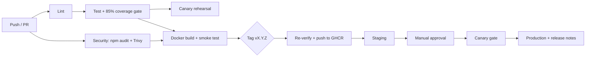

# ShipGate

A release-risk scoring API (`POST /score`) built to show a complete CI/CD pipeline,
not just a pile of YAML. Zero npm dependencies; requires Node 22+.

## Try it in VS Code

```bash
npm run verify        # lint + tests with coverage gate + healthy canary
npm run canary:chaos  # deliberately bad canary: exits 1 = ROLLBACK (this is correct!)
npm start             # then: ./scripts/smoke-test.sh http://localhost:3000
```
Or use **Terminal > Run Task** (`.vscode/tasks.json`).

## The pipeline



## What each piece demonstrates

| Concept | Where |
|---|---|
| Continuous integration, fail-fast ordering | `ci.yml`: lint, then test, then the rest |
| Quality gates | Coverage threshold in `npm run test:coverage`; custom linter rules |
| Concurrency control | `concurrency` cancels superseded runs |
| Least privilege | `permissions: contents: read` in CI |
| Shift-left security | `npm audit` and Trivy scan |
| Immutable artifacts | Docker image tagged with version/commit, built once |
| Smoke testing a real container | `scripts/smoke-test.sh` |
| Progressive delivery | `scripts/canary.js` decides PROMOTE or ROLLBACK from error rate |
| **Testing the rollback itself** | CI job runs a chaos canary and *fails if it gets promoted* |
| Environment promotion + approvals | `cd.yml`: staging, then production with reviewers |
| Release automation | Tag-triggered publish and generated release notes |
| Risk-aware shipping | The app's own domain: Friday-afternoon deploys score worse |

## Using it on GitHub

1. Push to a new repo. CI runs on every push and PR.
2. Settings > Environments: create `staging` and `production`; add required reviewers to production.
3. Release: `git tag v1.0.1 && git push --tags`.

## Ideas to extend

Swap the echo deploy steps for a real target, add Dependabot, or call `/score` from CI
to block high-risk PRs automatically.
